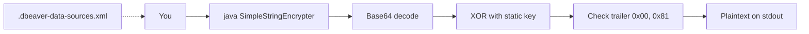
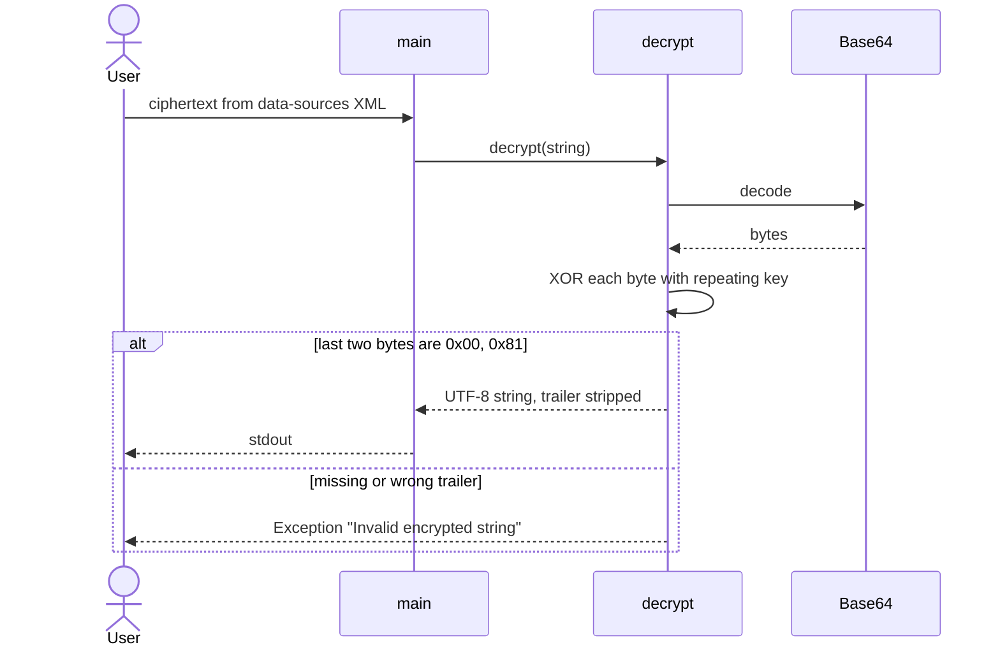

# Repo guide: dbeaver-password-retriever

Private onboarding guide for [bkzhn-knockcrm/dbeaver-password-retriever](https://github.com/bkzhn-knockcrm/dbeaver-password-retriever). Read-only pass. No files were written to the repo.

Reviewed: default branch `master` @ `735a8ba` (2026-02-05, “Fix formatting of passwordToDecrypt variable”). Remote tree has four blobs and no CI.

## TL;DR

A two-class Java fork of [jaisonpjohn/dbeaver-password-retriever](https://github.com/jaisonpjohn/dbeaver-password-retriever). It reverses DBeaver’s **legacy** password obfuscation: Base64, then XOR with a static key baked into both classes, then a 2-byte trailer check. There is no build, no tests, no config, and no network.

Use `SimpleStringEncrypter` (interactive). `DbeaverPasswordDecrypter` is the same decrypt path with a hardcoded sample and a package declaration that does not match the directory layout.

This does not talk to a database. It only decodes a ciphertext you already have, typically from your own `.dbeaver-data-sources.xml`. Newer DBeaver credential storage is a different scheme. Inferred: this tool will not open those.

## Tech stack

- Language: Java only. No `pom.xml`, Gradle build, or declared JDK version.
- Runtime: `javac` / `java`. No third-party libraries. `SimpleStringEncrypter` vendors a `Base64` class in the same file; `DbeaverPasswordDecrypter` inlines a smaller decoder.
- Data stores, queues, HTTP, auth: none.
- License: none on the repo.

## Architecture

One local flow. No services.





Encrypt (only on `SimpleStringEncrypter`, not called by `main`) does the reverse: UTF-8 bytes, append `0x00` and `0x81` (`-127`), XOR, Base64.

Both classes share the same key constant, `PASSWORD_ENCRYPTION_KEY`. It is a public DBeaver legacy constant, not a secret you configure. Do not treat this as encryption.

No persistence, so no ERD.

## Codebase map

| Path | Role |
|---|---|
| `SimpleStringEncrypter.java` | No package. Interactive `main`. `encrypt` + `decrypt`. Vendored `Base64`. This is what the README runs. |
| `DbeaverPasswordDecrypter.java` | `package com.pclutil`. Decrypt only. `main` prints `decrypt` of a hardcoded sample, then exits. Custom Base64, no `encrypt`. |
| `README.md` | Usage. Stale. Points at the upstream clone URL. |
| `.gitignore` | Generic Gradle/IDE template. No Gradle project exists. Ignores `*.class`, which is the only build output. |

There is no `src/`, `docs/`, `AGENTS.md`, `CLAUDE.md`, `CONTRIBUTING.md`, test tree, or `.github/`.

## Conventions

- Almost none. Two copies of the same algorithm, different style (spacing, `length()` vs `isEmpty()`, exception wrapping).
- Errors are thrown as `new Exception(cause)` and lose the original type. Empty input is `IllegalArgumentException`.
- Decrypt requires the trailer. A raw XOR/Base64 string without `0x00 0x81` is rejected even if the XOR worked.
- Base64 decode skips characters outside the alphabet, so spaces in a pasted token are ignored rather than rejected.
- `main` in the packaged class writes the recovered value with `System.out.print` and no newline.

## Entry points

1. `SimpleStringEncrypter.main` — prompt on stderr, read one line from `System.console()`, decrypt, print plaintext on stdout.
2. `DbeaverPasswordDecrypter.main` — no prompt. Decrypts the hardcoded `passwordToDecrypt` sample.
3. `decrypt(String)` on either class — the only real logic. Start here if you are changing behavior.

Fork delta: parent is `jaisonpjohn/dbeaver-password-retriever`. The only commit unique to the message history inspected here is `735a8ba`, a formatting edit of `passwordToDecrypt` in `DbeaverPasswordDecrypter.java`. History before that matches the upstream README/SO lineage (2018–2023).

## External dependencies

None at runtime.

The ciphertext comes from a local DBeaver file the README names as `.dbeaver-data-sources.xml`. This program does not open that file. You copy the value in.

Inferred, not verified against a DBeaver checkout: current DBeaver often stores credentials in `credentials-config.json` or the OS keychain, with a master password. Those blobs will not round-trip through this XOR. Confirm on the version you care about before relying on the tool.

## Related repos

| Repo | How found | Why it matters |
|---|---|---|
| [jaisonpjohn/dbeaver-password-retriever](https://github.com/jaisonpjohn/dbeaver-password-retriever) | GitHub `parent` on this fork. Also the `git clone` URL in README. | Upstream. This repo has not replaced that URL. |
| [Stack Overflow #39928401](https://stackoverflow.com/questions/39928401/recover-db-password-stored-in-my-dbeaver-connection/39928445#39928445) | First link in README. | Origin of the approach. README’s sample session is copied from there. |
| [dbeaver/dbeaver](https://github.com/dbeaver/dbeaver) | Inferred from class and constant names, not from an import. | Source of the legacy obfuscation. Read it to see which versions still emit this format. |

## Local dev guide

**Prerequisites.** A JDK with `javac` and `java`. No version pin. No Maven/Gradle. Docker, env files, and fixtures: none.

**Run the interactive tool** (matches the README, from a real terminal):

```sh
git clone https://github.com/bkzhn-knockcrm/dbeaver-password-retriever.git
cd dbeaver-password-retriever
javac SimpleStringEncrypter.java
java SimpleStringEncrypter
```

Paste the ciphertext at the prompt. Plaintext goes to stdout. The prompt and the echo of what you typed go to stderr.

**Run the packaged class.** The file lives at the repo root but declares `package com.pclutil`, so a bare `javac` + `java com.pclutil...` will not find the class.

```sh
javac -d . DbeaverPasswordDecrypter.java
java com.pclutil.DbeaverPasswordDecrypter
```

That prints the hardcoded sample. It does not read stdin.

**What to mock.** Nothing. No remote dependency. Do not point this at someone else’s credential file. If you need a fixture, use `encrypt` on a string you choose, or the sample already in source. There is no fake, container, or feature flag in the repo.

**Env vars.** None. No `.env.example`, no `appsettings`, no system properties.

**Tests / lint / CI.** None. `.github/workflows` is absent (API 404). `.gitignore` mentions Gradle and IDE files that this repo does not have.

**Gotchas**

- `System.console()` is null when stdin is not a TTY (IDE run button, pipe, some CI). `readLine()` then NPEs. The README does not say this.
- README clone URL is the upstream repo, not `bkzhn-knockcrm/dbeaver-password-retriever`.
- README example ciphertext is `QlZVQKA =` (embedded space). The decoder skips the space, so it can still decode. That is accidental, not documented.
- README sample output `123` is the Stack Overflow illustration. This pass did not execute it.
- The two decryptors can drift. A fix in one file does not apply to the other.
- `encrypt` is dead from `main` (the call is commented out).
- Typo in both Base64 decoders: `"Internal Errror"`.
- No license file. Reuse and redistribution are unclear.

## Doc accuracy

| Doc | Verdict | Notes |
|---|---|---|
| `README.md` | Misleading | Wrong clone URL for this fork. Omits `DbeaverPasswordDecrypter.java` and the `com.pclutil` compile layout. Example has a stray space. No JDK, TTY, or “legacy format only” warning. Steps `clone → javac SimpleStringEncrypter.java → java SimpleStringEncrypter` are right for that one class. |
| `AGENTS.md`, `CLAUDE.md`, `CONTRIBUTING.md`, `docs/` | Missing | Nothing to verify. |
| `.gitignore` | Stale | Copied from a Gradle/IDE template. Harmless, but it implies a build that is not here. |

## Open questions

- Which DBeaver versions still write this XOR form, and under what file name on macOS vs Windows vs Linux?
- Should `DbeaverPasswordDecrypter` stay? It duplicates `SimpleStringEncrypter` and its `main` only decrypts a constant.
- Was the 2026 formatting commit the only intended fork change?
- Add a license? Upstream also has none visible from this pass.
- Is a console-less entry point (`args[0]`) wanted, given `System.console()` breaks outside a TTY?
- No tests. A round-trip of `encrypt` → `decrypt` on a known string would lock the trailer and key handling. Not run in this pass.
